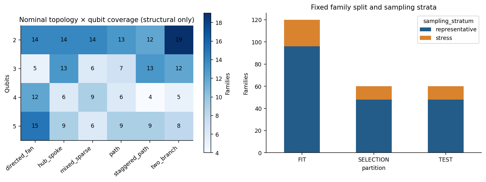
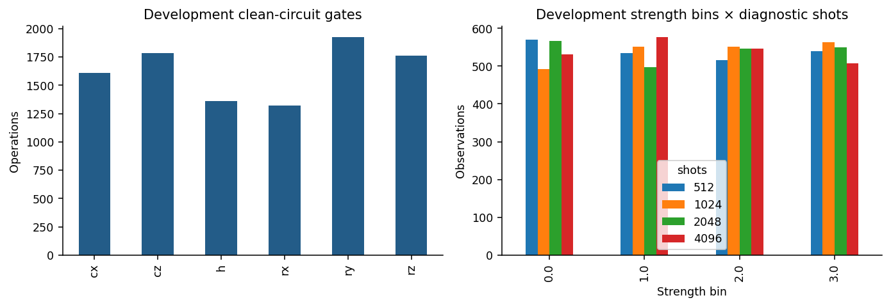
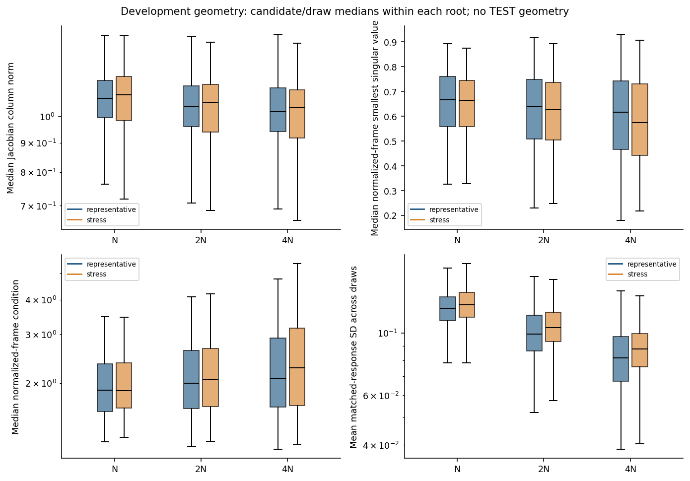
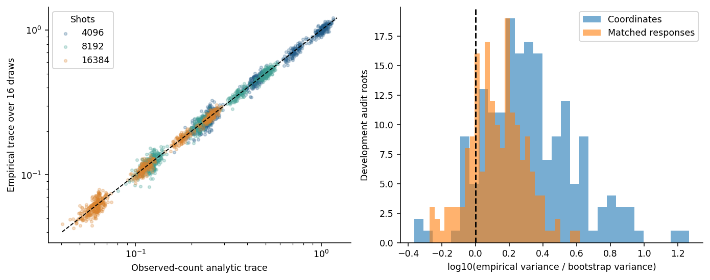
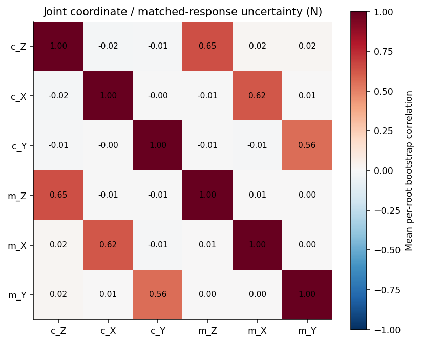

# Finite-shot cohort: exploratory data analysis

Cohort identity: `sha256:1448ca1ebbdf50149d0200dae4c6ed9eb8a39156c18e329e42ea74ca3d10203d`. Acquisition-time status: **CONSTRUCTED_QUARANTINED_PENDING_INDEPENDENCE_AND_AUDIT**. Current adjudication: **INTERNALLY_VERIFIED_QUARANTINED_EXTERNAL_INDEPENDENCE_UNVERIFIED**; see `COHORT_ACCEPTANCE.json`.

This is a descriptive data-quality report. No frozen-network inference, accuracy measurement, remedy selection, or TEST outcome analysis was performed. All measurement/geometry plots use FIT and SELECTION only. TEST contributes structural counts and integrity checks in the separate audit.

## Principal descriptive findings

- The full design materialized: 240 families, 960 roots, 12,480 observations; 16 independent calibration draws at each budget. FIT/SELECTION/TEST family counts are 120/60/60, with 192 representative and 48 stress-selected families.
- All four qubit counts, six nominal topologies, six layer counts and three injection contexts occur. The realized distribution is admission-conditioned: 86 two-qubit families versus 42 four-qubit families, and 40 pre-entangling versus 105 post-entangling families. No post-EDA balancing was performed.
- Development mechanism/nuisance Cramér V is zero for every predeclared nuisance because mechanism is fully crossed. Shot/strength-bin V is 0.02645.
- Analytic observed-count Jacobian uncertainty tracks empirical variability: median empirical/estimated trace ratio is 0.996 at N; approximate nominal-95% mean-J coverage is 94.97%. These checks apply to the first ordered candidate, not every possible feature estimator.
- Nonlinear joint uncertainty needs more validation: at N, median empirical/bootstrap trace ratios are 1.96 for coordinates and 1.34 for matched responses. Median maximum absolute coordinate/matched bootstrap correlation is 0.805. These are conditional, single-candidate audit results with 16 acquisition draws and 64 bootstrap replicates, not universal bias guarantees.
- Increasing calibration shots reduced mean matched-response SD from 0.1248 at N to 0.0836 at 4N, while coordinate SD rose from 1.763 to 2.072. These descriptive feature-scale statistics do not establish prediction performance or a remedy.
- The frozen stress rule is broad: 105/144 (72.9%) representative development families also satisfy it. The 80/20 split is a **sampling** split, not a disjoint easy/hard classification.

Primary machine-generated report and figures came from the preregistered committed run. This final text adds human interpretation and the separately identified non-selecting audit updates. The original run text is preserved in `EDA_REPORT_RUN_ORIGINAL.md`; no data or selection criterion was changed.

## Sampling, coverage and denominator

| partition   | sampling_stratum   |   families |
|:------------|:-------------------|-----------:|
| FIT         | representative     |         96 |
| FIT         | stress             |         24 |
| SELECTION   | representative     |         48 |
| SELECTION   | stress             |         12 |
| TEST        | representative     |         48 |
| TEST        | stress             |         12 |

Total: 240 families, 960 clean roots and 12480 diagnostic observations. Each root shares its calibration across its 13 observations. Draws and candidates are dependent descendants; they are not independent circuit samples.

Qubit × nominal topology counts:

|   n_qubits |   directed_fan |   hub_spoke |   mixed_sparse |   path |   staggered_path |   two_branch |
|-----------:|---------------:|------------:|---------------:|-------:|-----------------:|-------------:|
|          2 |             14 |          14 |             14 |     13 |               12 |           19 |
|          3 |              5 |          13 |              6 |      7 |               13 |           12 |
|          4 |             12 |           6 |              9 |      6 |                4 |            5 |
|          5 |             15 |           9 |              6 |      9 |                9 |            8 |

Topology × injection context counts (structural metadata):

| topology_class   |   inter_entangling |   post_entangling_recombination |   pre_entangling |
|:-----------------|-------------------:|--------------------------------:|-----------------:|
| directed_fan     |                 15 |                              18 |               13 |
| hub_spoke        |                 13 |                              22 |                7 |
| mixed_sparse     |                 12 |                              14 |                9 |
| path             |                 16 |                              16 |                3 |
| staggered_path   |                 18 |                              16 |                4 |
| two_branch       |                 21 |                              19 |                4 |

The six nominal topology labels are grammar choices, not six guaranteed graph-isomorphism classes. At two qubits they share one edge. Topology/context overlap with historical data is intentional; complete ordered skeleton duplication is excluded.

## Acquisition and experimental balance

Each root has 16 independent calibration realizations at each of N=4096, 2N=8192 and 4N=16384 **per axis/sign/basis call**. There are 18 calls per candidate per draw. Diagnostic shots remain 512/1024/2048/4096; reference and observed samples are independent. Diagnostics are held fixed across calibration draws, so this study isolates calibration randomness.

Development injected strengths:

|   strength_bin |     min |   median |    max |   count |
|---------------:|--------:|---------:|-------:|--------:|
|              0 | 0.05007 |  0.08593 | 0.1199 |    2160 |
|              1 | 0.12    |  0.1615  | 0.1999 |    2160 |
|              2 | 0.2004  |  0.2408  | 0.28   |    2160 |
|              3 | 0.2803  |  0.3213  | 0.36   |    2160 |

Development mechanism counts: {"ry_overrotation": 2880, "rx_overrotation": 2880, "rz_drift": 2880}; clean controls: 720.

Mechanism/nuisance Cramér V (zero is exact fully crossed balance, not statistical independence of all continuous variables):

| nuisance         |   Cramers_V |
|:-----------------|------------:|
| n_qubits         |           0 |
| topology_class   |           0 |
| reference_layers |           0 |
| context          |           0 |
| shots            |           0 |
| strength_bin     |           0 |
| partition        |           0 |
| sampling_stratum |           0 |

Shot/strength-bin Cramér V = 0.02645. A root-specific random permutation balances shot levels within each root; random finite-cohort residual associations are reported, not corrected after inspection.

## Admission and rejected screening population

| reason                                |   attempts |
|:--------------------------------------|-----------:|
| nonidentifiable_at_original_admission |        376 |
| outside_preregistered_stress_rule     |         16 |

Development screening attempts = 572. Representative families that also meet the stress geometry rule: 72.9%. Sampling strata therefore are not disjoint difficulty classes. Failed original admission is recorded as a screening population, not silently dropped from the target population. TEST screening details remain sealed.

Original admission is a mechanism-separation test at strength 0.12. It does not prove identifiability at every smaller strength or certify matrix full rank. Null local derivatives and non-identifiable finite mechanisms are different properties.

## Geometry and numerical behavior

| sampling_stratum   |   budget |   median_column_norm |   median_smin |   median_condition |   coordinate_sd_mean |   matched_sd_mean |
|:-------------------|---------:|---------------------:|--------------:|-------------------:|---------------------:|------------------:|
| representative     |     4096 |                1.075 |        0.6661 |              1.88  |                1.648 |           0.1221  |
| representative     |     8192 |                1.04  |        0.6383 |              1.995 |                1.732 |           0.09922 |
| representative     |    16384 |                1.02  |        0.6159 |              2.072 |                1.894 |           0.08151 |
| stress             |     4096 |                1.091 |        0.6635 |              1.875 |                1.642 |           0.126   |
| stress             |     8192 |                1.057 |        0.626  |              2.058 |                1.75  |           0.1046  |
| stress             |    16384 |                1.036 |        0.5751 |              2.265 |                1.963 |           0.08764 |

Rows above summarize medians over root summaries. Increased shots need not monotonically improve nonlinear coordinate or normalized-direction features, particularly near weak/null directions. Boxplots suppress plotting outliers for readability; all observations remain in CSV summaries and all quantile ranges remain in JSON. No EDA-driven filtering was applied.

## Count uncertainty, bias and covariance validation

|       budget |   trace_ratio_empirical_over_estimated |   approx95_mean_j_coverage |   mean_absolute_jacobian_bias |
|-------------:|---------------------------------------:|---------------------------:|------------------------------:|
| 4096         |                                 0.996  |                     0.9524 |                      0.01587  |
| 8192         |                                 0.9977 |                     0.9524 |                      0.01123  |
|    1.638e+04 |                                 0.9987 |                     0.9549 |                      0.007976 |

The analytic covariance is estimated from observed counts only, with the N−1 unbiased correction and correlated statistics within a basis. Calibration plus/minus and basis blocks are acquired independently. Empirical trace uses 16 calibration draws of the first ordered candidate; that trace is noisy. The nominal 95% mean-J coverage uses normal intervals against the transient simulator central-difference target, excludes zero-variance cells, and is descriptive, not a formal coverage guarantee. Finite-difference truncation relative to the infinitesimal derivative is not estimated here.

Analytic covariance minimum numerical eigenvalue: -1.51e-17; joint bootstrap minimum: 0. Tiny negative values reflect floating-point roundoff, not silent covariance repair.

Joint uncertainty: 180 development roots, one first-ordered candidate and opaque first observation each, N draw zero, 64 observed-count bootstrap replicates. Diagnostic evidence is held fixed. Empirical/bootstrapped coordinate trace ratio quantiles: {"min": 0.4332886309231705, "p10": 1.0534987772972617, "median": 1.9576641089484195, "p90": 4.421800828938932, "max": 18.54436770122117}. Matched trace ratio quantiles: {"min": 0.5339849265615788, "p10": 0.8682510103901843, "median": 1.3363489190813398, "p90": 2.1788254406744203, "max": 4.1844595471149555}.

Coordinate and matched-response estimates arise from the same noisy response frame and must not be treated as independent. A bootstrap can disagree strongly with empirical variation at sparse/null boundaries. These results validate calculability and expose calibration limitations; they do not validate an uncertainty-based stabilization remedy. All six-by-six per-root matrices are retained in `joint_bootstrap_covariances.json`.

## Family-cluster descriptive intervals

|   budget | metric             |    mean |   low95 |   high95 |   families | unit                       | interpretation                 |
|---------:|:-------------------|--------:|--------:|---------:|-----------:|:---------------------------|:-------------------------------|
|     4096 | matched_sd_mean    | 0.1248  | 0.1226  |  0.1269  |        180 | family, equal-weight means | descriptive bootstrap interval |
|     4096 | coordinate_sd_mean | 1.763   | 1.691   |  1.841   |        180 | family, equal-weight means | descriptive bootstrap interval |
|     8192 | matched_sd_mean    | 0.1019  | 0.0996  |  0.1042  |        180 | family, equal-weight means | descriptive bootstrap interval |
|     8192 | coordinate_sd_mean | 1.871   | 1.777   |  1.97    |        180 | family, equal-weight means | descriptive bootstrap interval |
|    16384 | matched_sd_mean    | 0.08356 | 0.08112 |  0.08597 |        180 | family, equal-weight means | descriptive bootstrap interval |
|    16384 | coordinate_sd_mean | 2.072   | 1.954   |  2.199   |        180 | family, equal-weight means | descriptive bootstrap interval |

Intervals resample equal-weight family means, 2,000 bootstrap replicates with a fixed reporting seed. They quantify descriptive uncertainty within this generated cohort, not population guarantees or remedy efficacy.

## Integrity, scientific limitations and verdict

The separate independent audit checks hashes, shot mass, split isolation, blind-field allowlists and source-reconstructed measurements/features. Its independent simulator replay uses the same Qiskit library and is not an independent hardware replication.

**Inherited structural proxy:** the original generator puts its first RY on the intended affected qubit. This association is present in the known clean graph. We preserve it to retain the task; removal would change the experimental distribution. Explicit true-location fields are absent from estimator inputs, but this corpus cannot support a claim of location-uninformative circuit structure.

**Updated historical exclusion coverage:** the supplemental audit found zero matches against the checked early training graph inventories and the 150-family/600-root spent holdout, including the graph identities of all 36 selected diagnostics. The original 750-family/3,000-root development exclusion also passed. Inaccessible sealed/future reserves, an exhaustive historical registry, and missing early-product family/operation signatures remain unverified. No protected reserve was opened. This blocks stabilization-development admission; see `INDEPENDENT_AUDIT.md` and `SUPPLEMENTAL_AUDIT.md`.

No claim is made about prediction accuracy, improvement, optimal shot count, or hardware transfer. Raw arrays, recipe hashes, code, source bindings and versioned archive references are documented separately. TEST labels and recipes are encrypted; this report never decrypted them.

## Reproduction data products

`eda_summary.json`, `root_geometry_summary.csv`, `uncertainty_calibration.csv`, `joint_bootstrap_covariances.json`, `split_counts.csv`, and five figures are generated by `scripts/cohort/eda.py`. Full ranges, covariance outliers and stratum tables remain in those machine-readable products.

## Supplemental structural and count audit

Partition-specific structural tables and joint coverage gaps are in [SUPPLEMENTAL_AUDIT.md](SUPPLEMENTAL_AUDIT.md). There are four missing qubit/topology cells in SELECTION and one in TEST. All valid samples are retained. Development count-frequency quantiles by qubit count, budget and stratum are in `count_frequency_quantiles_development.csv`.

The supplemental path independently reproduced all six basis/reference-observed count groups for 156 development observations and checked all 720 development root label schedules. It never opened TEST arrays or decrypted TEST truth. These checks assess data generation correctness, not model accuracy. The original audit separately performed integrity checks on every blind TEST bundle without publishing its difficulty statistics.
